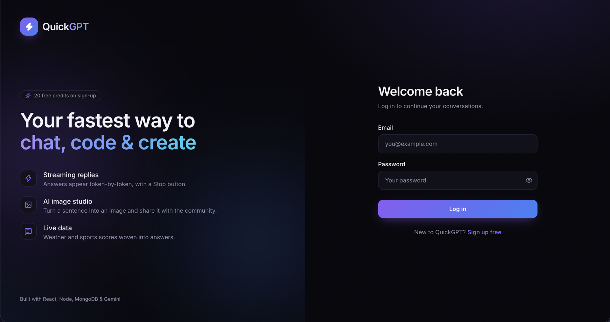

# 🤖 QuickGPT — Full Stack AI Chatbot (MERN + Gemini + Voice + Live Data)

<div align="center">


**A production-style full-stack AI chatbot: streaming replies, hands-free voice conversations, live weather / markets / sports, image generation, shareable chats, credits and Razorpay payments.**

[🌐 Live Demo](https://quickgptreact.vercel.app/) · [🐛 Report Bug](https://github.com/singhayush007/QUICK_GPT/issues) · [✨ Request Feature](https://github.com/singhayush007/QUICK_GPT/issues)

</div>

---



---

## 📋 Table of Contents

- [About](#-about)
- [Features](#-features)
- [Tech Stack](#-tech-stack)
- [Architecture](#️-architecture)
- [Folder Structure](#️-folder-structure)
- [Getting Started](#-getting-started)
- [Environment Variables](#-environment-variables)
- [Running the App](#️-running-the-app)
- [Scripts, Tests & CI](#-scripts-tests--ci)
- [API Overview](#-api-overview)
- [Voice & Browser Support](#️-voice--browser-support)
- [Deployment](#️-deployment)
- [Contributing](#-contributing)
- [License](#-license)

---

## 📖 About

**QuickGPT** is a full-stack MERN AI chatbot platform designed for real-world usage.

- **Users** sign up, chat with an AI that **streams its answers token by token**, and can talk to it **hands-free by voice**.
- **Live data** (weather, air quality, Nifty / Sensex, currencies, crypto, cricket / football / NBA scores) is shown on a dedicated page **and** woven into chat answers.
- **Image generation** runs through ImageKit; images can be shared to a community gallery.
- **Credits** meter usage; **Razorpay** sells more credits. Free and Pro **models and voices** are separated by plan.
- **Gemini** is the primary provider with an **OpenRouter** fallback. Model lists are configurable from the environment.

---

## ✨ Features

| Feature | Description |
| --- | --- |
| 🔐 **JWT Authentication** | Signup / login with bcrypt hashing, 30-day tokens, rate-limited auth endpoints |
| ⚡ **Streaming Chat** | Server-Sent Events, **Stop** button (aborts the provider call and refunds the credit), regenerate, auto-titled chats |
| 🧠 **Models & Personas** | **Lite** and **Flash** are free; **Pro** needs a paid plan (enforced on the server). Personas: Code expert, Tutor, Writer, Mock interviewer, Translator |
| 🎙️ **Voice Conversation** | Talk to the AI hands-free: speak → pause **3 s** → it answers **out loud** → it listens again. Hindi / English, interrupt anytime |
| 🗣️ **Voices** | Device voice + **4 male and 2 female** premium Gemini voices (some free, some Pro) with live previews |
| 🌦️ **Live Data** | Weather + 5-day forecast, AQI, Nifty / Sensex / Bank Nifty / VIX, USD · EUR · GBP · AED → ₹, BTC · ETH · SOL, live cricket · football · NBA — auto-refreshing |
| 🖼️ **AI Image Generation** | Prompt-to-image via ImageKit (square / landscape / portrait), optional publish to the community gallery |
| 🔗 **Share Chats** | Public read-only **snapshot** links (no login needed), revocable, first-name only, importable into your own chats |
| 🪙 **Credit System** | Atomic credit reservation + automatic refund on failure / stop; purchase history |
| 💳 **Razorpay Payments** | Order creation, signature verification (timing-safe) and a raw-body webhook that credits exactly once |
| 📝 **Rich Replies** | Markdown, tables, syntax-highlighted code with copy, read-aloud, copy, export chat as `.md` |
| 🧭 **Chat Management** | Rename, pin, delete, date-grouped list, search (`⌘/Ctrl + K`) |
| 💻 **Responsive UI** | Modern dark / light theme, mobile drawer, no horizontal overflow from 320 px to 4K |
| 🛡️ **Hardening** | Helmet, rate limits, input validation, generic error messages, `.env` placeholder detection |
| ☁️ **Deployment Ready** | Split client / server deployment for Vercel |

---

## 💻 Tech Stack

### Frontend (`client`)


### Backend (`server`)


-4285F4?style=flat&logo=google&logoColor=white)


---

## 🏗️ Architecture

QuickGPT uses a **feature-based architecture** on both sides (conventions live in [`CLAUDE.md`](./CLAUDE.md)).

```
Browser                                   Express API                          External
┌──────────────────────────┐   HTTPS    ┌──────────────────────────────┐   ┌───────────────────────┐
│ React + TypeScript SPA   │ ─────────► │ routes → controller → service │ ─►│ Gemini (text + TTS)   │
│ features/ · shared/      │ ◄───SSE─── │            → Mongoose models  │   │ OpenRouter (fallback) │
│ zustand + TanStack Query │            │ rate limiters · helmet · CORS │   │ ImageKit · Razorpay   │
└──────────────────────────┘            └──────────────┬───────────────┘   │ Open-Meteo · NSE · ESPN│
                                                       ▼                   └───────────────────────┘
                                                  MongoDB Atlas
```

**Client layering** — enforced by ESLint (`no-restricted-imports`), so cycles can't creep back in:

```
app  →  features  →  store  →  shared (api · constants · types · utils · services)
```

- `shared/` never imports `features/` or `app/`; its low-level folders never import the store.
- `store/` (zustand) only depends on `shared/`.
- Features import each other only along explicit edges (`chat → share, voice`, `sidebar → auth`).
- Server data lives in **TanStack Query**, client state in **zustand**; components never call axios directly.

**Server layering** — `route (+ rate limiter, auth) → controller → service → model / provider`. Controllers are the only layer that touches `req` / `res`; services hold the business logic (credit reserve / refund, history building, live-data enrichment, snapshots, payment verification).

---

## 🗂️ Folder Structure

```bash
QUICK_GPT/
│
├── client/                        # Frontend (React 19 + Vite + TypeScript strict + Tailwind 4)
│   └── src/
│       ├── app/                   # App shell: App.tsx · layout/AppShell · providers/AppProviders
│       ├── features/<name>/       # auth · chat · sidebar · voice · share · live · credits · community
│       │   ├── views/             #   page components (what a route renders)
│       │   ├── components/        #   feature-private UI
│       │   ├── hooks/             #   TanStack Query hooks & state machines (UseXxx.ts)
│       │   ├── services/          #   axios calls — the only place that knows endpoint paths
│       │   └── constants/ types/ util/
│       ├── shared/                # api · components/ui · components/messages · constants · hooks
│       │                          # lib · services · types · utils
│       └── store/                 # zustand: authStore · chatStore · preferencesStore · themeStore
│
├── server/                        # Backend (Node.js 22 + Express 5, ESM)
│   ├── server.js / app.js         # entry + app factory (Vercel-ready)
│   ├── config/                    # db + lazy third-party clients (Gemini, ImageKit, OpenRouter, Razorpay)
│   ├── modules/<feature>/         # auth · chat · message · credits · share · live · voice · community
│   ├── shared/                    # middlewares (rate limiters, error handler) · utils · constants
│   └── tests/                     # node:test suite (unit + HTTP, no database needed)
│
├── docs/
│   ├── ENV_REFERENCE.md           # every environment variable explained
│   └── screenshots/
├── .github/workflows/ci.yml       # typecheck · lint · test · build on every push / PR
├── CLAUDE.md                      # naming + architecture conventions
└── README.md
```

More detail: [`server/README.md`](./server/README.md) · [`docs/ENV_REFERENCE.md`](./docs/ENV_REFERENCE.md)

---

## 🏁 Getting Started

### Prerequisites

- [Node.js](https://nodejs.org/) v22 recommended (Vite 7 needs v20.19+)
- [npm](https://www.npmjs.com/) v9+
- [MongoDB Atlas](https://www.mongodb.com/cloud/atlas) account (free M0 cluster is enough)
- [Google AI Studio](https://aistudio.google.com/app/apikey) key (Gemini) — **required**
- [ImageKit](https://imagekit.io/dashboard) account — optional, enables image generation
- [Razorpay](https://dashboard.razorpay.com) account — optional, enables credit purchases

### 1. Clone the repository

```bash
git clone https://github.com/singhayush007/QUICK_GPT.git
cd QUICK_GPT
```

### 2. Install dependencies

```bash
# Server
cd server && npm install

# Client
cd ../client && npm install
```

---

## 🔐 Environment Variables

Both packages include `.env.example` templates. Values that still look like placeholders (`your_…`) are treated as **not configured** — the matching feature is switched off with a clear message instead of calling the provider with fake credentials. Full reference: [`docs/ENV_REFERENCE.md`](./docs/ENV_REFERENCE.md).

### Server (`server/.env`)

```bash
cp server/.env.example server/.env
```

| Variable | Required | Description |
| --- | --- | --- |
| `MONGODB_URI` | ✅ | MongoDB connection string (URL-encode special characters in the password, e.g. `@` → `%40`) |
| `JWT_SECRET` | ✅ | JWT signing secret |
| `GEMINI_API_KEY` | ✅ | Gemini key — chat, streaming and the premium voices |
| `USE_GEMINI` | | `true` = try Gemini first, falling back to OpenRouter |
| `GEMINI_MODELS_LITE` / `_FLASH` / `_PRO` | | Comma-separated model ids per tier. Google retires models often — override here without a code change |
| `OPENROUTER_API_KEY`, `OPENROUTER_MODEL`, `OPENROUTER_REFERRER` | | Fallback AI provider |
| `IMAGEKIT_PUBLIC_KEY`, `IMAGEKIT_PRIVATE_KEY`, `IMAGEKIT_URL_ENDPOINT` | | Image generation |
| `RAZORPAY_KEY_ID`, `RAZORPAY_KEY_SECRET`, `RAZORPAY_WEBHOOK_SECRET` | | Payments |
| `CORS_ORIGIN` | | Comma-separated allowed frontend origins (default: all) |
| `PORT` | | Server port (default `3000`) |

### Client (`client/.env`)

```bash
cp client/.env.example client/.env
```

| Variable | Description |
| --- | --- |
| `VITE_SERVER_URL` | Backend API URL (default `http://localhost:3000`) |
| `VITE_RAZORPAY_KEY_ID` | Razorpay public key for client checkout |

---

## ▶️ Running the App

Open **two terminals** and run:

```bash
# Terminal 1 — Backend (http://localhost:3000)
cd server
npm run server
```

```bash
# Terminal 2 — Frontend (http://localhost:5173)
cd client
npm run dev
```

Then open **http://localhost:5173**, sign up (you get **20 free credits**) and start chatting.

> Image generation and payments stay disabled until the ImageKit / Razorpay keys are set — everything else works with just MongoDB + Gemini.

---

## 🧪 Scripts, Tests & CI

| Where | Command | What it does |
| --- | --- | --- |
| `client` | `npm run dev` | Vite dev server |
| `client` | `npm run typecheck` | `tsc --noEmit` (strict) |
| `client` | `npm run lint` | ESLint incl. the architecture-boundary rules |
| `client` | `npm test` | Vitest — utils, SSE parser, speech chunking, stores |
| `client` | `npm run build` | Typecheck + production build (vendor chunks split) |
| `server` | `npm run server` | Dev server with nodemon |
| `server` | `npm test` | `node --test` — services, prompts, caching, voice/model catalogues, and the real Express app over HTTP (no DB required) |

GitHub Actions ([`ci.yml`](./.github/workflows/ci.yml)) runs typecheck, lint, tests and build for the client and syntax + tests for the server on every push and pull request.

---

## 🔌 API Overview

All endpoints live under `/api`. Everything except the public ones needs `Authorization: <token>` (a `Bearer` prefix also works).

| Area | Endpoints |
| --- | --- |
| **User** | `POST /user/register` · `POST /user/login` · `GET /user/data` · `GET /user/published-images` *(public)* |
| **Chat** | `GET /chat/create` · `GET /chat/get` · `POST /chat/rename` · `POST /chat/pin` · `POST /chat/delete` |
| **Message** | `GET /message/models` · `POST /message/text` · `POST /message/stream` *(SSE)* · `POST /message/image` |
| **Credits** | `GET /credit/plan` · `GET /credit/history` · `POST /credit/purchase` · `POST /credit/verify` · `POST /razorpay` *(webhook)* |
| **Share** | `POST /share/create` · `POST /share/remove` · `POST /share/import` · `GET /share/:shareId` *(public, `no-store`, `noindex`)* |
| **Live** | `GET /live/weather` · `/live/aqi` · `/live/markets` · `/live/scores?sport=cricket\|football\|basketball` |
| **Voice** | `GET /voice/list` · `POST /voice/speak` *(returns `audio/wav`)* |
| **Health** | `GET /health` |

Live data comes from free, key-less sources: **Open-Meteo** (weather, AQI), **NSE** and **Moneycontrol** (Indian indices), **CoinGecko**, **open.er-api.com** (FX) and **ESPN** (scores). Responses are cached briefly and fall back to the last good value if a provider is down.

---

## 🎙️ Voice & Browser Support

- Voice conversation uses the browser's **Web Speech API** for listening — use **Chrome, Edge or Safari**.
- **Brave** blocks Google's speech service, so the mic can't work there (the app shows a clear message).
- Allow microphone access when the browser asks (🔒 icon in the address bar).
- **Premium voices** are generated on the server (Gemini TTS) and need the Gemini key; the **device voice** works offline and is the automatic fallback.
- Free-tier Gemini keys have limited quota and no Pro-model quota; if replies fail with a rate-limit message, wait a minute or use a key with billing.

---

## ☁️ Deployment

Deploy **server** and **client** as separate Vercel projects.

| Service | Recommended For |
| --- | --- |
| [Vercel](https://vercel.com) | Client + Server hosting |
| [MongoDB Atlas](https://www.mongodb.com/cloud/atlas) | Database |
| [ImageKit](https://imagekit.io/) | AI image generation/media |
| [Razorpay](https://razorpay.com/) | Payments |

> Make sure all required environment variables are configured in project settings before deployment, and set `CORS_ORIGIN` to your deployed client URL.

---

## 🤝 Contributing

Contributions are welcome:

1. Fork the repository
2. Create a branch: `git checkout -b feature/your-feature-name`
3. Read [`CLAUDE.md`](./CLAUDE.md) for the naming and layering rules, and run `npm test` + `npm run lint` in the package you touched
4. Commit changes: `git commit -m "feat: your feature description"`
5. Push branch: `git push origin feature/your-feature-name`
6. Open a Pull Request

---

## 📄 License

This project is licensed under the **MIT License**.

---

<div align="center">
  Made with ❤️ by <a href="https://github.com/singhayush007">Ayush Singh</a>
</div>
